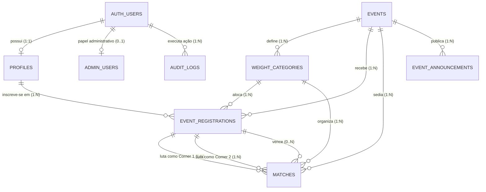

# U.C.U ARENA — Modelagem Relacional de Dados

**Versão:** 1.0.0  
**Motor:** PostgreSQL 15+ (Supabase)  
**Conformidade:** 3ª Forma Normal (3NF), Integridade Referencial Estrita, RLS Ready

---

## 1. Diagrama Entidade-Relacionamento (ERD)



---

## 2. Dicionário de Dados e Entidades

### 2.1. `profiles` (Perfis Públicos e Privados dos Atletas)
Armazena as informações biográficas, de contato e dados sensíveis de menores.
- **`id`** (`UUID`, PK, DEFAULT `gen_random_uuid()`): Identificador único do perfil.
- **`auth_user_id`** (`UUID`, FK -> `auth.users.id`, UNIQUE, NOT NULL): Vínculo com a conta de autenticação.
- **`full_name`** (`TEXT`, NOT NULL): Nome civil completo do participante.
- **`nickname`** (`VARCHAR(30)`, UNIQUE, NOT NULL): Apelido de combate único (usado no login e exibição pública).
- **`nickname_normalized`** (`VARCHAR(30)`, GENERATED ALWAYS AS `LOWER(TRIM(nickname))` STORED): Coluna gerada para indexação e buscas case-insensitive seguras.
- **`recovery_email`** (`VARCHAR(255)`, NOT NULL): E-mail privado para recuperação de acesso e notificações (nunca exposto publicamente).
- **`phone`** (`VARCHAR(20)`, NOT NULL): Telefone/WhatsApp do atleta com DDD.
- **`birth_date`** (`DATE`, NOT NULL): Data de nascimento para cálculo dinâmico de maioridade.
- **`is_minor`** (`BOOLEAN`, NOT NULL DEFAULT `false`): Flag indicativa se o atleta é menor de 18 anos.
- **`guardian_name`** (`TEXT`, NULL): Nome completo do responsável legal (obrigatório se `is_minor = true`).
- **`guardian_relationship`** (`VARCHAR(50)`, NULL): Grau de parentesco (Pai, Mãe, Tutor Legal).
- **`guardian_phone`** (`VARCHAR(20)`, NULL): Contato do responsável.
- **`guardian_document`** (`VARCHAR(30)`, NULL): Documento confidencial do responsável (CPF/RG).
- **`image_consent`** (`BOOLEAN`, NOT NULL DEFAULT `false`): Consentimento para uso de imagem e transmissão.
- **`terms_consent`** (`BOOLEAN`, NOT NULL DEFAULT `false`): Aceite das regras gerais da U.C.U Arena.
- **`avatar_url`** (`TEXT`, NULL): URL pública da foto de perfil no Supabase Storage.
- **`created_at`** (`TIMESTAMPTZ`, DEFAULT `NOW()`): Data de criação.
- **`updated_at`** (`TIMESTAMPTZ`, DEFAULT `NOW()`): Última atualização.

### 2.2. `admin_users` (Administradores Autorizados)
Garante o controle de acesso ao painel com validação em nível de banco de dados.
- **`user_id`** (`UUID`, PK, FK -> `auth.users.id` ON DELETE CASCADE): Usuário autenticado.
- **`role`** (`VARCHAR(20)`, NOT NULL DEFAULT `'superadmin'`): Papel de sistema.
- **`is_active`** (`BOOLEAN`, NOT NULL DEFAULT `true`): Flag de atividade da conta.
- **`created_at`** (`TIMESTAMPTZ`, DEFAULT `NOW()`).

*Nota de Arquitetura:* O sistema é configurado inicialmente com exatamente **um** registro de administrador principal. A tabela impede que contas comuns acessem qualquer operação restrita.

### 2.3. `events` (Eventos e Campeonatos)
Centraliza as configurações de cada edição realizada pela U.C.U Arena.
- **`id`** (`UUID`, PK, DEFAULT `gen_random_uuid()`).
- **`slug`** (`VARCHAR(60)`, UNIQUE, NOT NULL): Identificador para URL amigável (ex.: `arena-01-combate-de-ouro`).
- **`title`** (`VARCHAR(150)`, NOT NULL): Nome do evento (ex.: "U.C.U Arena: Edição Inaugural").
- **`description`** (`TEXT`, NULL): Resumo e chamada promocional.
- **`event_date`** (`TIMESTAMPTZ`, NOT NULL): Data e horário de início das lutas.
- **`location_name`** (`VARCHAR(120)`, NOT NULL): Nome do local (ex.: "Centro de Treinamento U.C.U").
- **`location_address`** (`TEXT`, NOT NULL): Endereço físico completo.
- **`location_map_url`** (`TEXT`, NULL): Link do Google Maps para fácil navegação.
- **`whatsapp_group_url`** (`TEXT`, NULL): Link do grupo oficial do evento para atletas inscritos.
- **`rules_markdown`** (`TEXT`, NOT NULL): Regulamento oficial em formato Markdown.
- **`banner_url`** (`TEXT`, NULL): Arte oficial em destaque.
- **`logo_url`** (`TEXT`, NULL): Brasão/logo do evento.
- **`min_weight`** (`NUMERIC(5,2)`, NOT NULL DEFAULT `50.00`): Peso mínimo geral permitido.
- **`max_weight`** (`NUMERIC(5,2)`, NOT NULL DEFAULT `90.00`): Peso máximo geral permitido.
- **`status`** (`VARCHAR(25)`, NOT NULL DEFAULT `'draft'`):
  - Valores válidos: `'draft'` (Rascunho), `'open_for_registration'` (Inscrições Abertas), `'registration_closed'` (Inscrições Encerradas), `'in_progress'` (Evento em Andamento), `'finished'` (Concluído), `'cancelled'` (Cancelado).
- **`format_type`** (`VARCHAR(25)`, NOT NULL DEFAULT `'mixed'`):
  - Valores válidos: `'mixed'` (Misto), `'friendly'` (Lutas Casadas / Amistosas), `'single_elimination'` (Mata-Mata), `'round_robin'` (Liga de Pontos).
- **`created_by`** (`UUID`, FK -> `auth.users.id`).
- **`created_at`** (`TIMESTAMPTZ`, DEFAULT `NOW()`).
- **`updated_at`** (`TIMESTAMPTZ`, DEFAULT `NOW()`).

### 2.4. `weight_categories` (Categorias de Peso por Evento)
Permite que cada evento configure suas faixas, garantindo ausência de lacunas.
- **`id`** (`UUID`, PK, DEFAULT `gen_random_uuid()`).
- **`event_id`** (`UUID`, FK -> `events.id` ON DELETE CASCADE, NOT NULL).
- **`name`** (`VARCHAR(60)`, NOT NULL): Nome da categoria (ex.: "Peso Leve (50 a 60 kg)").
- **`min_weight`** (`NUMERIC(5,2)`, NOT NULL): Limite inferior da faixa em kg.
- **`max_weight`** (`NUMERIC(5,2)`, NOT NULL): Limite superior da faixa em kg.
- **`display_order`** (`INT`, NOT NULL DEFAULT `1`): Ordem de listagem na tela.
- **`created_at`** (`TIMESTAMPTZ`, DEFAULT `NOW()`).
- **Restrição de Checagem (`CHECK`):** `CHECK (min_weight < max_weight)`.

### 2.5. `event_registrations` (Inscrições dos Atletas no Evento)
Liga o perfil do atleta ao evento específico e categoria de peso.
- **`id`** (`UUID`, PK, DEFAULT `gen_random_uuid()`).
- **`event_id`** (`UUID`, FK -> `events.id` ON DELETE RESTRICT, NOT NULL).
- **`profile_id`** (`UUID`, FK -> `profiles.id` ON DELETE RESTRICT, NOT NULL).
- **`weight_category_id`** (`UUID`, FK -> `weight_categories.id` ON DELETE RESTRICT, NOT NULL).
- **`declared_weight`** (`NUMERIC(5,2)`, NOT NULL): Peso informado no momento da inscrição.
- **`verified_weight`** (`NUMERIC(5,2)`, NULL): Peso aferido na balança oficial pela organização.
- **`status`** (`VARCHAR(20)`, NOT NULL DEFAULT `'pending'`):
  - Valores válidos: `'pending'` (Pendente de análise), `'approved'` (Aprovado / Confirmado), `'rejected'` (Recusado pela moderação), `'withdrawn'` (Desistência formal do atleta).
- **`rejection_reason`** (`TEXT`, NULL): Justificativa em caso de recusa.
- **`guardian_authorized`** (`BOOLEAN`, NOT NULL DEFAULT `false`): Flag validada pelo admin para menores.
- **`checkin_status`** (`BOOLEAN`, NOT NULL DEFAULT `false`): Confirmação de presença no local do evento.
- **`registered_at`** (`TIMESTAMPTZ`, DEFAULT `NOW()`).
- **`reviewed_by`** (`UUID`, FK -> `auth.users.id`, NULL).
- **`reviewed_at`** (`TIMESTAMPTZ`, NULL).
- **Restrição de Unicidade:** `UNIQUE(event_id, profile_id)` (impede dupla inscrição no mesmo evento).

### 2.6. `matches` (Confrontos / Lutas)
Registra o casamento das lutas, status em tempo real, resultado oficial e vídeo.
- **`id`** (`UUID`, PK, DEFAULT `gen_random_uuid()`).
- **`event_id`** (`UUID`, FK -> `events.id` ON DELETE RESTRICT, NOT NULL).
- **`weight_category_id`** (`UUID`, FK -> `weight_categories.id` ON DELETE RESTRICT, NOT NULL).
- **`match_order`** (`INT`, NOT NULL DEFAULT `1`): Posição no card de lutas.
- **`round_name`** (`VARCHAR(50)`, NOT NULL DEFAULT `'Luta Casada'`): Ex.: "Card Preliminar", "Semifinal", "Disputa de Cinturão".
- **`fighter1_registration_id`** (`UUID`, FK -> `event_registrations.id`, NOT NULL): Corner Vermelho.
- **`fighter2_registration_id`** (`UUID`, FK -> `event_registrations.id`, NOT NULL): Corner Dourado/Azul.
- **`status`** (`VARCHAR(20)`, NOT NULL DEFAULT `'scheduled'`):
  - Valores válidos: `'scheduled'` (Agendada), `'in_progress'` (No Ringue / Em Andamento), `'completed'` (Finalizada), `'cancelled'` (Cancelada / W.O.).
- **`winner_registration_id`** (`UUID`, FK -> `event_registrations.id`, NULL): Vencedor oficial do combate.
- **`victory_method`** (`VARCHAR(40)`, NULL):
  - Valores: `'KO'` (Nocaute), `'TKO'` (Nocaute Técnico), `'SUBMISSION'` (Finalização), `'POINTS'` (Decisão por Pontos), `'DQ'` (Desclassificação), `'DRAW'` (Empate), `'NO_CONTEST'` (Sem Resultado).
- **`score_details`** (`TEXT`, NULL): Detalhamento dos pontos ou round da vitória.
- **`video_url`** (`TEXT`, NULL): Link do vídeo do combate (YouTube, Vimeo, etc.).
- **`scheduled_time`** (`TIMESTAMPTZ`, NULL): Horário previsto do combate.
- **`completed_at`** (`TIMESTAMPTZ`, NULL): Momento de registro da vitória.
- **`notes`** (`TEXT`, NULL): Observações da arbitragem.
- **`created_at`** (`TIMESTAMPTZ`, DEFAULT `NOW()`).
- **`updated_at`** (`TIMESTAMPTZ`, DEFAULT `NOW()`).
- **Restrição de Checagem:** `CHECK (fighter1_registration_id <> fighter2_registration_id)` (um atleta não luta contra si mesmo).

### 2.7. `event_announcements` (Mural de Comunicados Oficiais)
- **`id`** (`UUID`, PK, DEFAULT `gen_random_uuid()`).
- **`event_id`** (`UUID`, FK -> `events.id` ON DELETE CASCADE, NOT NULL).
- **`title`** (`VARCHAR(150)`, NOT NULL).
- **`content_markdown`** (`TEXT`, NOT NULL).
- **`is_pinned`** (`BOOLEAN`, NOT NULL DEFAULT `false`).
- **`created_by`** (`UUID`, FK -> `auth.users.id`, NOT NULL).
- **`created_at`** (`TIMESTAMPTZ`, DEFAULT `NOW()`).

### 2.8. `audit_logs` (Trilha de Auditoria Administrativa)
Registra ações críticas para segurança e rastreabilidade.
- **`id`** (`UUID`, PK, DEFAULT `gen_random_uuid()`).
- **`user_id`** (`UUID`, FK -> `auth.users.id`, NOT NULL): Quem realizou a ação.
- **`action`** (`VARCHAR(50)`, NOT NULL): Ex.: `'APPROVE_REGISTRATION'`, `'UPDATE_WEIGHT'`, `'SET_MATCH_RESULT'`.
- **`entity_type`** (`VARCHAR(50)`, NOT NULL): Tabela afetada.
- **`entity_id`** (`UUID`, NOT NULL): Identificador do registro alterado.
- **`changes_payload`** (`JSONB`, NULL): Detalhes antes/depois da alteração.
- **`ip_address`** (`VARCHAR(45)`, NULL).
- **`created_at`** (`TIMESTAMPTZ`, DEFAULT `NOW()`).

---

## 3. DDL SQL Completo (Pronto para Execução no Supabase)

```sql
-- Habilita extensão de criptografia e UUIDs
CREATE EXTENSION IF NOT EXISTS "pgcrypto";

-- 1. TABELA DE PERFIS DE ATLETAS
CREATE TABLE public.profiles (
    id UUID PRIMARY KEY DEFAULT gen_random_uuid(),
    auth_user_id UUID NOT NULL UNIQUE REFERENCES auth.users(id) ON DELETE CASCADE,
    full_name TEXT NOT NULL,
    nickname VARCHAR(30) NOT NULL,
    nickname_normalized VARCHAR(30) GENERATED ALWAYS AS (LOWER(TRIM(nickname))) STORED UNIQUE,
    recovery_email VARCHAR(255) NOT NULL,
    phone VARCHAR(20) NOT NULL,
    birth_date DATE NOT NULL,
    is_minor BOOLEAN NOT NULL DEFAULT false,
    guardian_name TEXT,
    guardian_relationship VARCHAR(50),
    guardian_phone VARCHAR(20),
    guardian_document VARCHAR(30),
    image_consent BOOLEAN NOT NULL DEFAULT false,
    terms_consent BOOLEAN NOT NULL DEFAULT false,
    avatar_url TEXT,
    created_at TIMESTAMPTZ NOT NULL DEFAULT NOW(),
    updated_at TIMESTAMPTZ NOT NULL DEFAULT NOW(),
    CONSTRAINT check_guardian_if_minor CHECK (
        (is_minor = false) OR 
        (is_minor = true AND guardian_name IS NOT NULL AND guardian_phone IS NOT NULL AND guardian_document IS NOT NULL)
    ),
    CONSTRAINT check_consents CHECK (image_consent = true AND terms_consent = true)
);

-- 2. TABELA DE ADMINISTRADORES
CREATE TABLE public.admin_users (
    user_id UUID PRIMARY KEY REFERENCES auth.users(id) ON DELETE CASCADE,
    role VARCHAR(20) NOT NULL DEFAULT 'superadmin',
    is_active BOOLEAN NOT NULL DEFAULT true,
    created_at TIMESTAMPTZ NOT NULL DEFAULT NOW()
);

-- 3. TABELA DE EVENTOS
CREATE TABLE public.events (
    id UUID PRIMARY KEY DEFAULT gen_random_uuid(),
    slug VARCHAR(60) NOT NULL UNIQUE,
    title VARCHAR(150) NOT NULL,
    description TEXT,
    event_date TIMESTAMPTZ NOT NULL,
    location_name VARCHAR(120) NOT NULL,
    location_address TEXT NOT NULL,
    location_map_url TEXT,
    whatsapp_group_url TEXT,
    rules_markdown TEXT NOT NULL,
    banner_url TEXT,
    logo_url TEXT,
    min_weight NUMERIC(5,2) NOT NULL DEFAULT 50.00,
    max_weight NUMERIC(5,2) NOT NULL DEFAULT 90.00,
    status VARCHAR(25) NOT NULL DEFAULT 'draft',
    format_type VARCHAR(25) NOT NULL DEFAULT 'mixed',
    created_by UUID REFERENCES auth.users(id),
    created_at TIMESTAMPTZ NOT NULL DEFAULT NOW(),
    updated_at TIMESTAMPTZ NOT NULL DEFAULT NOW(),
    CONSTRAINT check_event_weights CHECK (min_weight >= 40.00 AND min_weight < max_weight AND max_weight <= 150.00),
    CONSTRAINT check_event_status CHECK (status IN ('draft', 'open_for_registration', 'registration_closed', 'in_progress', 'finished', 'cancelled')),
    CONSTRAINT check_format_type CHECK (format_type IN ('mixed', 'friendly', 'single_elimination', 'round_robin'))
);

-- 4. TABELA DE CATEGORIAS DE PESO
CREATE TABLE public.weight_categories (
    id UUID PRIMARY KEY DEFAULT gen_random_uuid(),
    event_id UUID NOT NULL REFERENCES public.events(id) ON DELETE CASCADE,
    name VARCHAR(60) NOT NULL,
    min_weight NUMERIC(5,2) NOT NULL,
    max_weight NUMERIC(5,2) NOT NULL,
    display_order INT NOT NULL DEFAULT 1,
    created_at TIMESTAMPTZ NOT NULL DEFAULT NOW(),
    CONSTRAINT check_category_weights CHECK (min_weight < max_weight)
);

-- 5. TABELA DE INSCRIÇÕES NO EVENTO
CREATE TABLE public.event_registrations (
    id UUID PRIMARY KEY DEFAULT gen_random_uuid(),
    event_id UUID NOT NULL REFERENCES public.events(id) ON DELETE RESTRICT,
    profile_id UUID NOT NULL REFERENCES public.profiles(id) ON DELETE RESTRICT,
    weight_category_id UUID NOT NULL REFERENCES public.weight_categories(id) ON DELETE RESTRICT,
    declared_weight NUMERIC(5,2) NOT NULL,
    verified_weight NUMERIC(5,2),
    status VARCHAR(20) NOT NULL DEFAULT 'pending',
    rejection_reason TEXT,
    guardian_authorized BOOLEAN NOT NULL DEFAULT false,
    checkin_status BOOLEAN NOT NULL DEFAULT false,
    registered_at TIMESTAMPTZ NOT NULL DEFAULT NOW(),
    reviewed_by UUID REFERENCES auth.users(id),
    reviewed_at TIMESTAMPTZ,
    CONSTRAINT unique_event_profile UNIQUE (event_id, profile_id),
    CONSTRAINT check_registration_status CHECK (status IN ('pending', 'approved', 'rejected', 'withdrawn')),
    CONSTRAINT check_declared_weight CHECK (declared_weight >= 40.00 AND declared_weight <= 150.00)
);

-- 6. TABELA DE CONFRONTOS (MATCHES)
CREATE TABLE public.matches (
    id UUID PRIMARY KEY DEFAULT gen_random_uuid(),
    event_id UUID NOT NULL REFERENCES public.events(id) ON DELETE RESTRICT,
    weight_category_id UUID NOT NULL REFERENCES public.weight_categories(id) ON DELETE RESTRICT,
    match_order INT NOT NULL DEFAULT 1,
    round_name VARCHAR(50) NOT NULL DEFAULT 'Luta Casada',
    fighter1_registration_id UUID NOT NULL REFERENCES public.event_registrations(id) ON DELETE RESTRICT,
    fighter2_registration_id UUID NOT NULL REFERENCES public.event_registrations(id) ON DELETE RESTRICT,
    status VARCHAR(20) NOT NULL DEFAULT 'scheduled',
    winner_registration_id UUID REFERENCES public.event_registrations(id) ON DELETE RESTRICT,
    victory_method VARCHAR(40),
    score_details TEXT,
    video_url TEXT,
    scheduled_time TIMESTAMPTZ,
    completed_at TIMESTAMPTZ,
    notes TEXT,
    created_at TIMESTAMPTZ NOT NULL DEFAULT NOW(),
    updated_at TIMESTAMPTZ NOT NULL DEFAULT NOW(),
    CONSTRAINT check_different_fighters CHECK (fighter1_registration_id <> fighter2_registration_id),
    CONSTRAINT check_match_status CHECK (status IN ('scheduled', 'in_progress', 'completed', 'cancelled')),
    CONSTRAINT check_victory_method CHECK (victory_method IS NULL OR victory_method IN ('KO', 'TKO', 'SUBMISSION', 'POINTS', 'DQ', 'DRAW', 'NO_CONTEST'))
);

-- 7. TABELA DE COMUNICADOS
CREATE TABLE public.event_announcements (
    id UUID PRIMARY KEY DEFAULT gen_random_uuid(),
    event_id UUID NOT NULL REFERENCES public.events(id) ON DELETE CASCADE,
    title VARCHAR(150) NOT NULL,
    content_markdown TEXT NOT NULL,
    is_pinned BOOLEAN NOT NULL DEFAULT false,
    created_by UUID NOT NULL REFERENCES auth.users(id),
    created_at TIMESTAMPTZ NOT NULL DEFAULT NOW()
);

-- 8. TABELA DE AUDITORIA
CREATE TABLE public.audit_logs (
    id UUID PRIMARY KEY DEFAULT gen_random_uuid(),
    user_id UUID NOT NULL REFERENCES auth.users(id),
    action VARCHAR(50) NOT NULL,
    entity_type VARCHAR(50) NOT NULL,
    entity_id UUID NOT NULL,
    changes_payload JSONB,
    ip_address VARCHAR(45),
    created_at TIMESTAMPTZ NOT NULL DEFAULT NOW()
);

-- GATILHO AUTOMÁTICO PARA ATUALIZAR updated_at
CREATE OR REPLACE FUNCTION public.set_updated_at()
RETURNS TRIGGER AS $$
BEGIN
    NEW.updated_at = NOW();
    RETURN NEW;
END;
$$ LANGUAGE plpgsql;

CREATE TRIGGER trg_profiles_updated_at BEFORE UPDATE ON public.profiles FOR EACH ROW EXECUTE FUNCTION public.set_updated_at();
CREATE TRIGGER trg_events_updated_at BEFORE UPDATE ON public.events FOR EACH ROW EXECUTE FUNCTION public.set_updated_at();
CREATE TRIGGER trg_matches_updated_at BEFORE UPDATE ON public.matches FOR EACH ROW EXECUTE FUNCTION public.set_updated_at();

-- ÍNDICES DE PERFORMANCE PARA ACESSO RÁPIDO
CREATE INDEX idx_profiles_auth_user ON public.profiles(auth_user_id);
CREATE INDEX idx_events_slug ON public.events(slug);
CREATE INDEX idx_events_status ON public.events(status);
CREATE INDEX idx_registrations_event ON public.event_registrations(event_id);
CREATE INDEX idx_registrations_profile ON public.event_registrations(profile_id);
CREATE INDEX idx_registrations_status ON public.event_registrations(status);
CREATE INDEX idx_matches_event ON public.matches(event_id);
CREATE INDEX idx_matches_category ON public.matches(weight_category_id);
```
