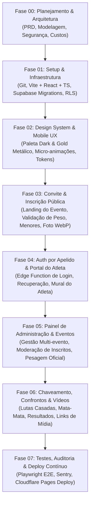

# U.C.U ARENA — Roadmap de Implementação Incremental

**Versão:** 1.0.0  
**Estratégia:** Desenvolvimento Orientado a Fases Modulares com Validação Contínua  
**Objetivo:** Entrega de um sistema de eventos de luta profissional, seguro, fluido e de alto impacto visual.

---

## 1. Visão Geral das Fases de Desenvolvimento

---

## 2. Detalhamento de Cada Fase

### Fase 00 — Planejamento e Arquitetura *(Concluída nesta fase)*
- [x] Inspecionar workspace e confirmar estado inicial limpo.
- [x] Elaborar o PRD completo com personas, fluxos e regras inegociáveis (`docs/product/PRD.md`).
- [x] Definir arquitetura Jamstack Serverless com Supabase e Cloudflare (`docs/architecture/ARCHITECTURE.md`).
- [x] Modelar o banco relacional PostgreSQL com constraints, índices e DDL SQL (`docs/architecture/DATA_MODEL.md`).
- [x] Especificar a segurança de login por apelido, RLS total e proteção de menores (`docs/security/SECURITY_AND_PRIVACY.md`).
- [x] Mapear limites de hospedagem gratuita e prevenção de pausa (`docs/deployment/FREE_HOSTING.md`).
- [x] Criar regras de conduta técnica e estética do projeto (`.agents/rules/ucu-project.md`).

### Fase 01 — Setup do Projeto, Infraestrutura e Banco de Dados
- **Objetivo:** Estabelecer a fundação de código limpo e aplicar o esquema no Supabase.
- **Entregáveis:**
  1. Inicialização do repositório Git e arquivo `.gitignore` rigoroso.
  2. Setup do projeto Vite com React 18 e TypeScript em modo estrito.
  3. Configuração do cliente Supabase (`src/lib/supabaseClient.ts`) com tipagem TypeScript gerada.
  4. Execução da migração SQL com todas as 8 tabelas relacionais, índices e políticas RLS.
  5. Criação da Edge Function `auth-login` para resolução de apelido no servidor.
  6. Configuração do bucket `avatars` no Supabase Storage.
- **Critério de Sucesso:** Conexão com o Supabase testada e tipagens validadas sem erros no build.

### Fase 02 — Design System Mobile-First & Identidade Visual
- **Objetivo:** Construir a base estética memorável: Preto Profundo e Ouro Metálico com animações ricas e fluidas.
- **Entregáveis:**
  1. Tokens de CSS (`src/styles/variables.css`): paleta de cores (hsl/hex), sombras douradas com glow, degradês metálicos e tipografia moderna (Google Fonts: *Cinzel* / *Outfit* ou *Inter*).
  2. Utilitários de animação (`src/styles/animations.css`): transições suaves de página, botões com efeito *gold-shimmer*, pulso de status de luta e badges dinâmicos.
  3. Componentes atômicos reutilizáveis:
     - `GoldButton`: Botão principal com micro-interações de clique e estado de carregamento.
     - `InputField`: Input com suporte a máscaras, ícones e validação inline em tempo real.
     - `Card`: Cartão em estilo vidro escuro (*dark glassmorphism*) com borda sutilmente iluminada.
     - `Modal` / `Drawer`: Janelas deslizantes nativas para mobile.
     - `SkeletonLoader`: Esqueletos de carregamento pulsantes em tons dourados escuros.
- **Critério de Sucesso:** Demonstração visual mobile-first aprovada, fluida a 60fps sem travamentos.

### Fase 03 — Módulo de Convite e Inscrição Pública
- **Objetivo:** Permitir que atletas acessem o link do evento e completem sua inscrição no celular com facilidade e segurança.
- **Entregáveis:**
  1. Página do Evento (`/e/:slug`):
     - Cabeçalho com banner oficial e contagem regressiva para o evento.
     - Resumo de data, hora e botão direto para navegação no Google Maps.
     - Regulamento oficial sanfonado (accordion) e link para o grupo de WhatsApp.
  2. Formulário de Inscrição Mobile (`/e/:slug/inscrever`):
     - Validação instantânea de apelido único (evita erros ao enviar).
     - Campo de peso decimal restrito estritamente entre `50,00 kg` e `90,00 kg` (duas casas decimais).
     - Componente de foto com corte prévio e conversão automática no navegador para formato WebP leve.
     - Lógica condicional de menor de idade: obrigatoriedade de responsável legal e aceite de termos de imagem.
  3. Tela de confirmação com badge de inscrição enviada para moderação.
- **Critério de Sucesso:** Inscrição ponta a ponta gravando no banco em estado `pending`, com foto no storage e campos validados.

### Fase 04 — Autenticação por Apelido & Portal do Participante
- **Objetivo:** Fornecer aos atletas um portal exclusivo para acompanhar seu status e confrontos.
- **Entregáveis:**
  1. Tela de Login (`/login`) aceitando apenas **Apelido** e **Senha**.
  2. Rota de recuperação de senha com disparo anônimo para o e-mail cadastrado.
  3. Portal do Atleta (`/atleta`):
     - Card do Atleta com foto, apelido, categoria alocada e peso declarado/oficial.
     - Status da inscrição (`Pendente`, `Aprovado`, `Recusado`, `Desistência`).
     - Próximo combate agendado: adversário (foto/apelido), corner (vermelho/dourado) e horário previsto.
     - Mural de avisos oficiais e comunicados urgentes do evento.
- **Critério de Sucesso:** Atleta faz login usando somente seu apelido, acessa suas informações privadas e não consegue ver dados restritos de outros atletas.

### Fase 05 — Painel de Administração & Gestão de Eventos
- **Objetivo:** Capacitar o Administrador Principal a controlar todo o ecossistema com agilidade no smartphone ou computador.
- **Entregáveis:**
  1. Proteção estrita de rotas administrativas (`/admin/*`) via validação de `admin_users` no banco.
  2. Módulo de Gestão de Eventos:
     - Criação de novos eventos (título, slug, data, local, WhatsApp, regras, banners).
     - Configuração dinâmica das 4 categorias de peso iniciais e faixas personalizadas sem lacunas.
  3. Módulo de Moderação de Inscrições:
     - Listagem com filtros de status (`Pendentes`, `Aprovadas`, `Recusadas`, `Desistências`).
     - Ações de aprovação com 1 clique e recusa com justificativa.
     - Registro da pesagem oficial (aferição decimal na balança no dia do evento).
- **Critério de Sucesso:** Admin consegue aprovar ou alterar o peso de um atleta e o resultado é refletido imediatamente no portal do participante.

### Fase 06 — Chaveamento, Confrontos & Resultados
- **Objetivo:** Organizar as lutas e registrar os vencedores em tempo real no dia do evento.
- **Entregáveis:**
  1. Interface de montagem de confrontos:
     - Casamento manual de lutas amistosas (Corner 1 vs Corner 2).
     - Geração de chaveamento mata-mata para categorias competitivas.
  2. Controle ao vivo de combate:
     - Alternância de status: `Agendada` -> `No Ringue` -> `Concluída`.
     - Registro do vencedor, método da vitória (Nocaute, Finalização, Pontos) e round.
     - Inclusão de link de vídeo/transmissão para gravação dos combates.
  3. Atualização automática do card público e do portal do atleta.
- **Critério de Sucesso:** Confrontos criados e finalizados com integridade, gerando histórico esportivo completo.

### Fase 07 — Testes, Auditoria, Observabilidade & Deploy Contínuo
- **Objetivo:** Garantir a máxima estabilidade, segurança e publicação gratuita no Cloudflare Pages.
- **Entregáveis:**
  1. Bateria de testes de integração com Playwright simulando navegação em telas mobile (iPhone e Android).
  2. Auditoria final de políticas RLS para garantir zero vazamento de dados.
  3. Integração do Sentry Web SDK para captura de exceções em tempo real.
  4. Configuração do CI/CD com Cloudflare Pages e arquivo de redirecionamento `_redirects`.
  5. Checklist de entrega e manual operacional para o organizador da U.C.U Arena.
- **Critério de Sucesso:** Aplicação em produção na URL pública da Cloudflare, com nota alta de performance (Lighthouse > 90) e custo zero.

---

## 3. Matriz de Riscos e Planos de Mitigação

| Risco Identificado | Impacto | Probabilidade | Estratégia de Mitigação |
| :--- | :---: | :---: | :--- |
| **Pausa da instância Supabase por 7 dias sem acesso** | Alto | Média | Aconselhamento de uso natural e configuração opcional de script de *heartbeat* gratuito no GitHub Actions. |
| **Upload de fotos gigantes esgotando o armazenamento** | Médio | Baixa | Compressão e redimensionamento automático de imagens diretamente no navegador antes do upload (formato WebP ~150KB). |
| **Tentativa de atletas forjarem aprovação ou peso pelo navegador** | Crítico | Baixa | Bloqueio total por Row Level Security (RLS) no PostgreSQL; regras no frontend são apenas de conveniência visual. |
| **Atletas esquecerem apelido ou senha** | Médio | Alta | Fluxo intuitivo de recuperação via apelido + envio seguro de link para o e-mail cadastrado, além de ferramenta de redefinição pelo admin. |
| **Conflito de faixas de peso ao criar categorias** | Médio | Baixa | Validação matemática no formulário e no banco impedindo sobreposições ou buracos no intervalo de pesos. |

---

## 4. Passos Manuais Necessários do Proprietário (Owner)

1. **Conta Supabase:** Criar a conta gratuita e obter a URL do projeto e as chaves de API (`anon` e `service_role`).
2. **Conta Cloudflare:** Criar a conta gratuita e conectar ao repositório GitHub da U.C.U Arena.
3. **Definição das Artes Oficiais:** Fornecer ou aprovar os logos e banners com a identidade visual dourada e preta.
