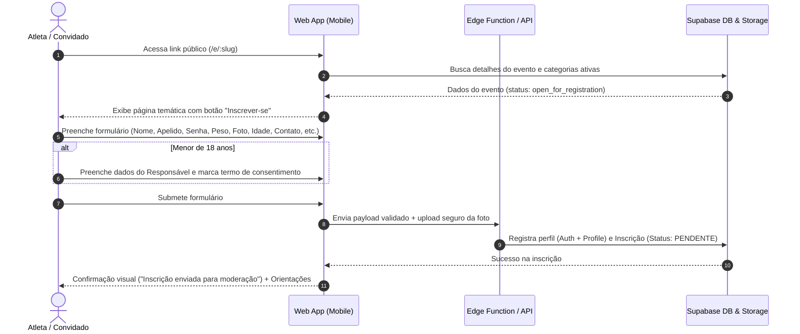

# U.C.U ARENA — Documento de Requisitos do Produto (PRD)

**Versão:** 1.0.0  
**Status:** Aprovado para Planejamento  
**Classificação:** Confidencial / Arquitetura Interna  
**Stack Principal:** Web Mobile-First, Cloudflare Pages, Supabase (PostgreSQL, Auth, Storage, Edge Functions)

---

## 1. Visão Geral do Produto

A **U.C.U Arena** é uma plataforma web progressiva e responsiva (com foco primário *mobile-first*) concebida para gerenciar múltiplos campeonatos e eventos esportivos de luta ao longo do tempo. O sistema centraliza desde o envio de convites públicos e inscrições de atletas até a pesagem oficial, moderação administrativa, chaveamento de confrontos (amistosos, eliminatórias e ligas), divulgação de resultados e comunicados oficiais.

Diferente de sistemas legados ou formulários dispersos, a U.C.U Arena oferece:
- Uma experiência visual de alto impacto (estética *Dark & Gold* metálico, moderna, dinâmica e viva).
- Acesso simplificado e memorável para atletas via **Apelido e Senha**.
- Rigor técnico na gestão de pesos e categorias sem lacunas ou sobreposições.
- Tratamento ético e em conformidade técnica com privacidade e proteção a atletas menores de idade.
- Painel administrativo centralizado para um Administrador Principal com controle total e seguro.

---

## 2. Personas e Papéis de Usuário

| Persona | Perfil e Contexto | Necessidades Principais | Permissões no Sistema |
| :--- | :--- | :--- | :--- |
| **Visitante / Convidado** | Lutador convidado ou entusiasta que acessa o link do evento pelo smartphone. | Visualizar detalhes do evento (data, local, regras, card preliminar) e realizar inscrição rápida e intuitiva. | Acesso somente leitura às páginas públicas do evento; submissão de cadastro de inscrição. |
| **Atleta / Participante** | Lutador inscrito que acompanha sua jornada no evento pelo celular. | Acessar com apelido e senha; acompanhar aprovação, pesagem, categoria, adversário definido, regras e grupo de WhatsApp. | Acesso autenticado ao **Portal do Atleta**; visualização dos seus dados, seu confronto e do evento em que está inscrito. |
| **Administrador Principal** | Organizador responsável por criar eventos, validar atletas e conduzir as lutas. | Painel ágil e infalível no celular ou desktop para moderar atletas, organizar chaves, registrar pesos e resultados. | Controle irrestrito sobre eventos, categorias, inscrições, confrontos, comunicados e auditoria. |

---

## 3. Jornadas e Fluxos de Usuário

### 3.1. Fluxo de Convite e Inscrição Pública

### 3.2. Fluxo de Autenticação por Apelido e Senha
1. O usuário acessa `/login`.
2. Digita seu **Apelido** (case-insensitive) e **Senha**.
3. O frontend consulta a função segura do servidor (`rpc` ou Edge Function) para resolver a credencial sem expor o e-mail real do atleta.
4. O Supabase Auth emite a sessão JWT segura com as claims do usuário.
5. O sistema redireciona automaticamente:
   - Se for o Administrador Principal -> `/admin`.
   - Se for Atleta -> `/atleta` (Portal do Participante).

### 3.3. Fluxo de Moderação e Pesagem Oficial (Administração)
1. O Administrador acessa `/admin/eventos/:id/inscricoes`.
2. Filtra por status: `Pendentes`, `Aprovadas`, `Recusadas`, `Desistências`.
3. Analisa os dados do atleta: foto, peso declarado, histórico, autorização de menor (se aplicável).
4. Ações possíveis:
   - **Aprovar**: Aloca o atleta na categoria de peso correspondente.
   - **Recusar**: Fornece justificativa (ex.: foto inadequada, dados inconsistentes).
   - **Registrar Pesagem Oficial**: Na pesagem presencial, o admin digita o peso verificado (ex.: `67.45 kg`). O sistema valida se o atleta permanece na faixa ou alerta sobre reenquadramento.
   - **Desistência**: Marca o atleta como desistente caso ocorra lesão ou ausência.

### 3.4. Fluxo de Confrontos, Chaveamento e Resultados
1. O Administrador acessa `/admin/eventos/:id/lutas`.
2. Seleciona a categoria e o formato:
   - **Amistoso (Casamento Direto)**: Seleciona Lutador A e Lutador B manualmente.
   - **Mata-Mata (Eliminatória Simples)**: O sistema gera as chaves (quartas, semifinais, final).
   - **Liga (Pontos Corridos)**: Todos contra todos dentro da categoria.
3. No dia da luta:
   - O admin altera o status da luta para `Em Andamento`.
   - Ao término, seleciona o vencedor, o método (Nocaute, Finalização, Pontos, Desclassificação) e anexa link de vídeo/transmissão caso disponível.
   - O resultado é refletido em tempo real no Portal do Atleta e na página do evento.

---

## 4. Regras de Negócio Detalhadas

### RN01 — Arquitetura de Múltiplos Eventos (Single-Org, Multi-Event)
- A plataforma não é um SaaS multi-empresa. Há **uma única organização proprietária** e um **Administrador Principal**.
- A plataforma é multi-eventos: novos eventos podem ser criados a qualquer momento (`U.C.U Arena 1`, `U.C.U Arena 2 - Edição de Inverno`, etc.).
- Cada evento possui seu próprio identificador único (`slug`), regras específicas, localização, horários, categorias, artes/banner e link do grupo de WhatsApp.

### RN02 — Pesagem e Categorias de Peso
- **Faixa padrão permitida:** `50,00 kg` a `90,00 kg` (duas casas decimais de precisão).
- **Categorias padrão iniciais por evento:**
  1. `50,00 kg a 60,00 kg`
  2. `Mais de 60,00 kg até 70,00 kg` (ex.: `60,01` a `70,00`)
  3. `Mais de 70,00 kg até 80,00 kg` (ex.: `70,01` a `80,00`)
  4. `Mais de 80,00 kg até 90,00 kg` (ex.: `80,01` a `90,00`)
- **Regra de Continuidade:** O administrador pode configurar faixas personalizadas por evento, desde que:
  - Não existam sobreposições (ex.: `60,00` em duas faixas ao mesmo tempo).
  - Não existam lacunas no intervalo coberto (ex.: pular de `60,00` para `62,00`).
  - O peso declarado ou medido deve obrigatoriamente se encaixar em uma única categoria ativa do evento.

### RN03 — Autenticação por Apelido e Senha
- Cada atleta deve escolher um **Apelido Único** no momento do cadastro.
- Apelidos são tratados como insensíveis a maiúsculas/minúsculas e sem espaços laterais (`"Guerreiro"` == `"guerreiro"`).
- O e-mail de recuperação é solicitado no cadastro, porém:
  - Permanece confidencial e não é visível publicamente em nenhuma tela.
  - O login público é feito exclusivamente por `Apelido` + `Senha`.
  - O sistema associa o apelido a um identificador interno seguro no Supabase.

### RN04 — Proteção de Menores e Consentimentos (Compliance Técnico)
- Participantes com idade inferior a 18 anos na data do evento são classificados como **Menores de Idade**.
- Para menores, são obrigatórios os seguintes campos no formulário:
  - Nome completo do responsável legal.
  - Grau de parentesco/vínculo.
  - Telefone de contato do responsável.
  - Documento de identificação do responsável (armazenado de forma confidencial).
  - Checkbox explícito de ciência e autorização de participação em evento de luta esportiva.
- **Cessão de Imagem:** Todos os atletas (e responsáveis, no caso de menores) devem aceitar o termo de gravação, fotografia e veiculação de imagem nos canais oficiais da U.C.U Arena.

### RN05 — Ciclo de Vida da Inscrição
- Toda inscrição nasce no estado `PENDENTE`.
- Apenas inscrições `APROVADAS` entram em sorteios, chaveamentos e confrontos.
- Atletas com inscrição `RECUSADA` recebem o feedback pelo portal (ex.: "Atualize sua foto de perfil").
- Atletas podem sinalizar `DESISTÊNCIA` pelo portal até o encerramento do prazo de pesagem, liberando a vaga e alertando a organização.

---

## 5. Telas e Estados da Interface (Mobile-First)

### 5.1. Matriz de Telas
1. **Pública / Convite (`/e/:slug`)**: Banner oficial, contagem regressiva, local com mapa, regras resumidas, card preliminar, botão de inscrição com destaque e link para entrar no grupo de WhatsApp.
2. **Formulário de Inscrição (`/e/:slug/inscrever`)**: Fluxo em etapas (*wizard* ou scroll progressivo otimizado para celular), validação de apelido em tempo real, upload de foto com recorte automático e preview.
3. **Login (`/login`)**: Formulário direto com apelido e senha, alternador de visibilidade de senha, link de "Esqueci minha senha".
4. **Portal do Atleta (`/atleta`)**:
   - Card do Atleta (Foto, apelido, peso oficial, categoria, status da inscrição).
   - Próximo Confronto (Adversário, horário estimado, regras do combate).
   - Comunicados do Evento (Mural de avisos em tempo real).
5. **Painel do Administrador (`/admin`)**:
   - Dashboard geral com contadores (Inscrições pendentes, lutas agendadas, peso médio).
   - Gestão de Eventos (Criar, editar status, configurar categorias).
   - Moderação de Inscrições e Pesagem (Filtros rápidos, aprovação com um toque, edição de peso).
   - Central de Lutas (Chaveamento interativo drag-and-drop ou seletor simplificado, registro de vencedor e link de vídeo).

### 5.2. Estados Obrigatórios de Interface
Para todas as páginas e componentes assíncronos:
- **Loading State:** Esqueletos animados (*skeleton screens*) elegantes em degradê preto e dourado, sem travamentos de tela.
- **Empty State:** Ilustrações/ícones temáticos de alta fidelidade com mensagens claras e botão de ação (ex.: "Nenhum confronto agendado ainda para esta categoria").
- **Error State:** Alertas contextuais com explicação amigável e botão para tentar novamente.
- **Success State:** Feedback visual dinâmico com micro-animações (ex.: badge de inscrição confirmada, confetes metálicos sutis ou check pulsante dourado).

---

## 6. Critérios de Aceitação (Definition of Done)

- [ ] Nenhum atleta consegue se cadastrar com peso fora do limite estipulado (mínimo `50,00 kg`, máximo `90,00 kg`).
- [ ] Atletas menores de 18 anos são impedidos de submeter a inscrição sem o preenchimento de todos os dados do responsável e aceite do termo.
- [ ] O login é concluído com sucesso utilizando apenas o apelido e a senha cadastrados.
- [ ] O e-mail de recuperação não vaza em nenhuma resposta de API ou rota pública de listagem.
- [ ] O Administrador Principal consegue aprovar/recusar atletas e cadastrar a pesagem oficial no smartphone sem quebras de layout.
- [ ] O sistema impede a exclusão de eventos que já possuam confrontos finalizados com histórico registrado.
