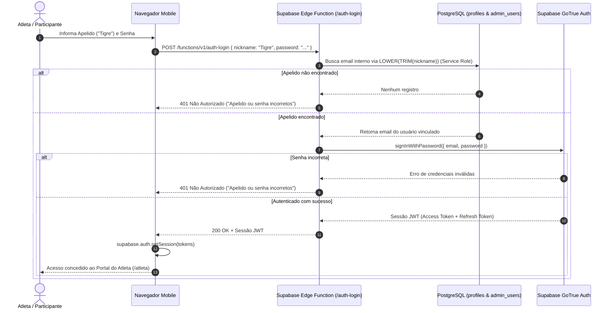

# U.C.U ARENA — Segurança, Autenticação e Privacidade

**Versão:** 1.0.0  
**Status:** Especificação de Segurança Aprovada  
**Princípio Central:** *Zero Trust Client* — Toda autorização e validação é garantida no servidor/banco de dados.

---

## 1. Modelo de Autenticação Segura por Apelido e Senha

O Supabase GoTrue Auth opera nativamente com pares de `email` e `senha` ou `telefone`. Para atender ao requisito de experiência de usuário da U.C.U Arena (onde lutadores se identificam pelo seu **Apelido** de combate sem expor seus e-mails publicamente), desenhamos uma solução segura de resolução server-side:

### 1.1. Arquitetura do Login por Apelido


### 1.2. Vantagens Desta Abordagem:
1. **Confidencialidade Absoluta:** O e-mail de recuperação do atleta nunca é enviado para o navegador de terceiros nem exposto no payload de listagens de lutadores.
2. **Prevenção de Enumeração de Contas:** A resposta para apelido inexistente ou senha incorreta é idêntica ("Apelido ou senha incorretos"), com tempo de resposta normalizado (*constant-time check* mitigando timing attacks).
3. **Compatibilidade Total com o Supabase:** O cliente web continua utilizando o cliente padrão `@supabase/supabase-js` com sessões JWT assinadas e renovação automática via `refresh_token`.

### 1.3. Fluxo de Recuperação de Senha
- No cadastro, o atleta informa obrigatoriamente um `recovery_email`.
- Na tela `/recuperar-senha`, o atleta digita seu apelido.
- A Edge Function localiza o e-mail confidencial correspondente e dispara o e-mail de redefinição oficial do Supabase Auth.
- A tela responde genericamente: *"Se o apelido estiver cadastrado, um link de recuperação foi enviado ao e-mail associado"*.

---

## 2. Provisionamento e Blindagem do Administrador Único

### 2.1. Conta de Administrador Principal
- A plataforma foi projetada para ter **um único Administrador Principal** nesta versão.
- A autorização administrativa é verificada no PostgreSQL através da tabela `admin_users` e de uma função auxiliar com privilégios `SECURITY DEFINER`:

```sql
-- Função helper para validação de privilégios em RLS
CREATE OR REPLACE FUNCTION public.is_admin()
RETURNS BOOLEAN AS $$
BEGIN
    RETURN EXISTS (
        SELECT 1 
        FROM public.admin_users 
        WHERE user_id = auth.uid() 
          AND is_active = true
    );
END;
$$ LANGUAGE plpgsql SECURITY DEFINER STABLE;
```

### 2.2. Provisionamento Inicial
- O administrador primário é criado inicialmente via script de migração ou diretamente pelo console seguro do Supabase.
- A inserção na tabela `admin_users` associa o `auth.uid()` do administrador.
- Nenhuma rota pública ou formulário permite a criação de novos administradores.

---

## 3. Políticas de Segurança em Nível de Linha (Row Level Security - RLS)

Todas as tabelas do banco de dados têm RLS habilitado obrigatoriamente. Nenhuma requisição anônima ou de usuário comum tem acesso irrestrito.

### 3.1. Matriz de Políticas RLS

```sql
-- Habilitação obrigatória de RLS em todas as tabelas
ALTER TABLE public.profiles ENABLE ROW LEVEL SECURITY;
ALTER TABLE public.admin_users ENABLE ROW LEVEL SECURITY;
ALTER TABLE public.events ENABLE ROW LEVEL SECURITY;
ALTER TABLE public.weight_categories ENABLE ROW LEVEL SECURITY;
ALTER TABLE public.event_registrations ENABLE ROW LEVEL SECURITY;
ALTER TABLE public.matches ENABLE ROW LEVEL SECURITY;
ALTER TABLE public.event_announcements ENABLE ROW LEVEL SECURITY;
ALTER TABLE public.audit_logs ENABLE ROW LEVEL SECURITY;

-- 1. PROFILES
-- Visualização pública de dados gerais dos atletas para o card de lutas
CREATE POLICY "Public profiles are visible by everyone" 
ON public.profiles FOR SELECT 
USING (true);

-- Apenas o próprio atleta ou o admin pode atualizar seu perfil
CREATE POLICY "Users can update own profile" 
ON public.profiles FOR UPDATE 
USING (auth.uid() = auth_user_id OR public.is_admin());

-- 2. EVENTS
-- Qualquer pessoa pode visualizar eventos que não estejam em rascunho
CREATE POLICY "Public can view published events" 
ON public.events FOR SELECT 
USING (status <> 'draft' OR public.is_admin());

-- Apenas o Administrador Principal pode criar, editar ou excluir eventos
CREATE POLICY "Only admin can manage events" 
ON public.events FOR ALL 
USING (public.is_admin());

-- 3. WEIGHT CATEGORIES
-- Todos podem visualizar as categorias de peso
CREATE POLICY "Public can view categories" 
ON public.weight_categories FOR SELECT 
USING (true);

-- Apenas admin gerencia categorias
CREATE POLICY "Only admin can manage categories" 
ON public.weight_categories FOR ALL 
USING (public.is_admin());

-- 4. EVENT REGISTRATIONS
-- Inscrições aprovadas são públicas para visualização de chaveamento e lista de atletas
CREATE POLICY "Approved registrations are public" 
ON public.event_registrations FOR SELECT 
USING (
    status = 'approved' 
    OR profile_id IN (SELECT id FROM public.profiles WHERE auth_user_id = auth.uid())
    OR public.is_admin()
);

-- Atletas autenticados podem se inscrever
CREATE POLICY "Authenticated athletes can register" 
ON public.event_registrations FOR INSERT 
WITH CHECK (
    profile_id IN (SELECT id FROM public.profiles WHERE auth_user_id = auth.uid())
);

-- Apenas o administrador altera status de inscrições e peso oficial
-- Atleta só pode alterar sua própria inscrição para 'withdrawn' (desistência)
CREATE POLICY "Admin modifies registrations or athlete withdraws" 
ON public.event_registrations FOR UPDATE 
USING (
    public.is_admin() 
    OR (profile_id IN (SELECT id FROM public.profiles WHERE auth_user_id = auth.uid()))
);

-- 5. MATCHES
-- Todos podem ver as lutas agendadas e concluídas
CREATE POLICY "Matches visible by everyone" 
ON public.matches FOR SELECT 
USING (true);

-- Apenas admin cria e atualiza confrontos e resultados
CREATE POLICY "Only admin manages matches" 
ON public.matches FOR ALL 
USING (public.is_admin());

-- 6. ANNOUNCEMENTS
-- Todos podem ler comunicados
CREATE POLICY "Announcements visible by everyone" 
ON public.event_announcements FOR SELECT 
USING (true);

-- Apenas admin gerencia comunicados
CREATE POLICY "Only admin manages announcements" 
ON public.event_announcements FOR ALL 
USING (public.is_admin());

-- 7. AUDIT LOGS
-- Somente o admin pode inspecionar os logs de auditoria
CREATE POLICY "Only admin views audit logs" 
ON public.audit_logs FOR SELECT 
USING (public.is_admin());
```

---

## 4. Proteção de Arquivos e Armazenamento (Supabase Storage)

Para as fotos de perfil dos atletas e banners do evento:
1. **Bucket `avatars`:**
   - Tipo: Público para leitura (para exibição rápida nas telas de card e chaveamento).
   - Políticas de Escrita no Storage:
     - Usuários anônimos são impedidos de fazer upload direto.
     - Usuários autenticados só podem gravar na subpasta associada ao seu próprio ID: `avatars/{auth.uid()}/*`.
     - Administrador pode gerenciar todas as fotos.
2. **Restrições de Mídia no Cliente e no Banco:**
   - Limite de tamanho máximo: `2 MB` por foto.
   - Formatos aceitos: `image/jpeg`, `image/png`, `image/webp`.
   - Sanitização de arquivos: Processamento no cliente antes do envio (recorte 1:1 e conversão para WebP).

---

## 5. Proteção de Menores e Privacidade de Dados (LGPD)

> **Aviso de Isenção Legal:** As medidas descritas constituem boas práticas de arquitetura de software e governança de dados no âmbito esportivo e técnico, não substituindo parecer ou consultoria jurídica formal.

### 5.1. Minimização de Dados e Tratamento de Menores (Estatuto da Criança e do Adolescente & LGPD)
1. **Consentimento Verificável do Responsável:**
   - Para atletas menores de 18 anos na data do evento, a inscrição só é concluída mediante o fornecimento dos dados completos do responsável legal (Nome, Parentesco, Telefone e Documento de Identidade).
   - O checkbox de declaração e autorização explícita é gravado com *timestamp* e IP no registro da inscrição.
2. **Sigilo de Dados Sensíveis:**
   - O documento do responsável e o e-mail de recuperação do atleta são acessíveis **exclusivamente pelo Administrador Principal**.
   - Esses campos nunca são retornados em consultas públicas do frontend.
3. **Cessão de Imagem Esportiva:**
   - Termo padronizado de cessão de direitos de imagem para transmissão, vídeos promocionais e registros fotográficos da U.C.U Arena, aceito no ato da inscrição.

---

## 6. Blindagem Contra Manipulação no Navegador e Segredos

1. **Separação de Chaves:**
   - O frontend React/Vite compila apenas as chaves públicas:
     - `VITE_SUPABASE_URL`
     - `VITE_SUPABASE_ANON_KEY`
   - A chave com poderes totais (`SUPABASE_SERVICE_ROLE_KEY`) **NUNCA** é exposta no código-fonte, repositório ou variáveis do frontend. Ela reside exclusivamente no ambiente interno das Supabase Edge Functions.
2. **Imutabilidade e Integridade de Dados Esportivos:**
   - Um atleta logado não consegue alterar seu peso declarado após a submissão, nem alterar o peso oficial ou forjar resultados de luta, pois o banco de dados rejeita qualquer instrução SQL direta via RLS.
